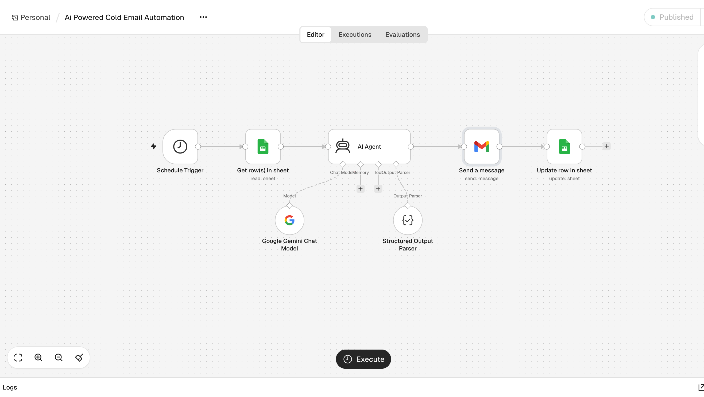

# Ai-powered-cold-email-automation
An AI-powered cold email automation workflow built using n8n, Google Gemini, Google Sheets, and Gmail to generate personalised emails, automate outreach, and track lead status.

## Overview

Businesses and professionals often spend considerable time researching potential clients and writing individual cold emails. Manually performing these tasks can be repetitive and time-consuming.

This project automates the cold email outreach process by combining AI-powered content generation with workflow automation.

## Problem Statement

Writing personalised cold emails for multiple potential clients requires manual effort, including:
- Collecting and managing lead information.
- Understanding each company's background.
- Writing relevant and personalised email content.
- Sending emails individually.
- Tracking the status of outreach activities.

## Solution

This workflow uses an AI Agent powered by Google Gemini to generate personalised cold emails based on the lead's name, company, and website.

The generated email is automatically sent through Gmail, and the corresponding lead's status is updated in Google Sheets.

## Workflow Architecture

1. **Schedule Trigger:** Initiates the workflow at scheduled intervals.
2. **Google Sheets – Get Rows:** Retrieves lead information from the spreadsheet.
3. **AI Agent (Google Gemini):** Generates a short, personalised cold email based on the available lead information.
4. **Structured Output Parser:** Organises the generated content into a structured JSON format containing the email subject and body.
5. **Gmail – Send Message:** Sends the personalised email to the lead.
6. **Google Sheets – Update Row:** Updates the lead's status to `Sent` after the email is sent.

## Technologies Used

| Technology | Purpose |
|---|---|
| n8n | Workflow automation |
| Google Gemini | AI-powered email generation |
| Google Sheets | Lead management and status tracking |
| Gmail | Automated email delivery |
| Structured Output Parser | Structured AI response |

## Key Features

- Automated cold email generation.
- AI-powered personalisation.
- Dynamic email subject and body generation.
- Automated email delivery through Gmail.
- Lead status tracking using Google Sheets.
- Reduced repetitive manual work.

## Workflow Preview

## How to Recreate

To build a similar workflow in n8n:

1. Create a new workflow in n8n.
2. Add a Schedule Trigger to initiate the automation.
3. Connect Google Sheets to retrieve lead information.
4. Integrate Google Gemini through an AI Agent to generate personalised cold emails.
5. Add a Structured Output Parser to organise the email subject and body.
6. Connect Gmail to send the generated emails.
7. Add a Google Sheets update node to track sent emails.
8. Configure the required credentials and test the workflow using sample leads.
9. 
## Future Improvements

- Process multiple leads in a single execution.
- Add email personalisation using deeper company research.
- Introduce human approval before sending emails.
- Implement error handling and retry mechanisms.
- Track email replies and outreach performance.
- Add reporting and analytics for campaign performance.

## Project Status

**Prototype – Built with n8n and AI integration.**

This project demonstrates how AI agents and workflow automation can be combined to streamline repetitive business processes.
